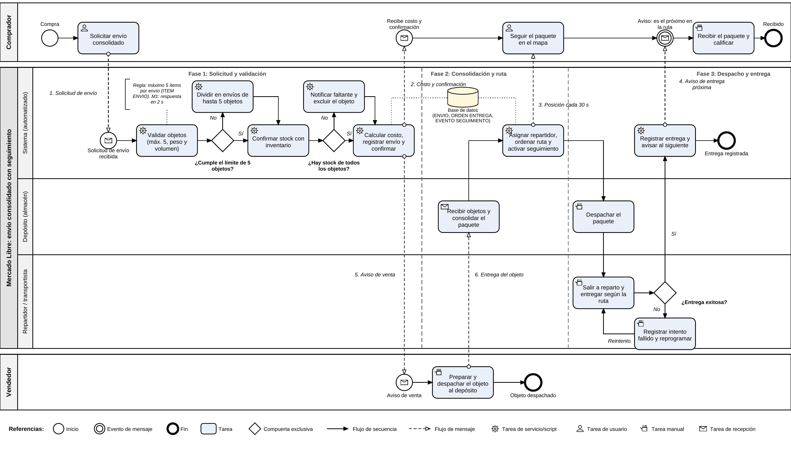

# Proceso de negocio: envío consolidado con seguimiento (BPMN)

## Participantes

| Participante | Tipo | Representa |
|---|---|---|
| Comprador | Pool (externo) | Solicita el envío, sigue el paquete y lo recibe |
| Vendedor | Pool (externo) | Despacha el objeto al depósito |
| Mercado Libre: envío consolidado con seguimiento | Pool (proceso) | Ejecuta el proceso |
| Sistema (automatizado) | Lane | Validaciones, costo, ruta, seguimiento y notificaciones |
| Depósito (almacén) | Lane | Recibe, consolida y despacha el paquete |
| Repartidor / transportista | Lane | Entrega según el orden de ruta |

## Fases

| Fase | Etapa |
|---|---|
| Fase 1 | Solicitud y validación |
| Fase 2 | Consolidación y ruta |
| Fase 3 | Despacho y entrega |

## Compuertas de decisión

| Compuerta | Pregunta | Excepción |
|---|---|---|
| G1 | ¿Cumple el límite de 5 objetos? | El sistema divide el pedido en envíos de hasta 5 objetos |
| G2 | ¿Hay stock de todos los objetos? | Notifica el faltante y excluye el objeto |
| G3 | ¿La entrega fue exitosa? | Registra el intento fallido y reprograma |

## Mensajes numerados

| N.º | Origen | Destino | Contenido |
|---|---|---|---|
| 1 | Solicitar envío consolidado (Comprador) | Sistema | Solicitud de envío |
| 2 | Calcular costo, registrar envío y confirmar | Comprador | Costo y confirmación. Con este mensaje continúa el flujo del comprador |
| 3 | Asignar repartidor, ordenar ruta y activar seguimiento | Comprador | Posición cada 30 s |
| 4 | Registrar entrega y avisar al siguiente | Comprador | Aviso de entrega próxima |
| 5 | Calcular costo, registrar envío y confirmar | Vendedor | Aviso de venta |
| 6 | Preparar y despachar el objeto al depósito | Depósito | Entrega del objeto. Con este mensaje comienza la tarea del depósito |

## Corrección del tutor

En dos puntos el flujo no continúa por una línea de secuencia sino por un flujo de mensaje. Se quitaron los flujos de secuencia entre «Solicitar envío consolidado» y «Recibe costo y confirmación» (pool Comprador), y entre «Calcular costo, registrar envío y confirmar» y «Recibir objetos y consolidar el paquete» (pool del sistema).
