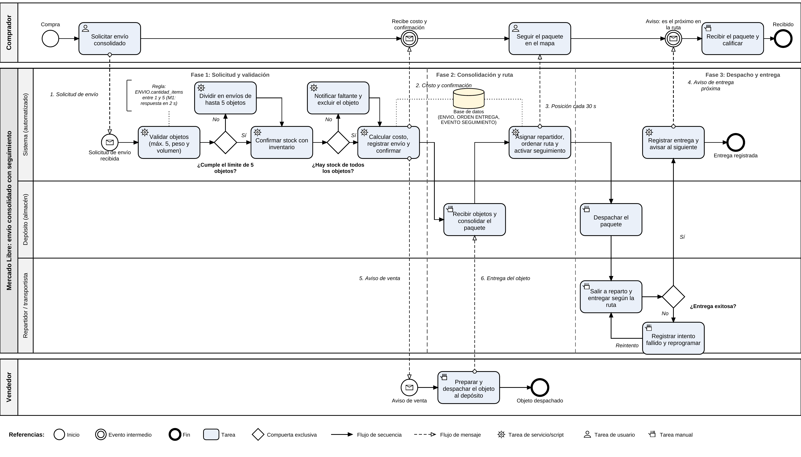

# Proceso de negocio: envío consolidado con seguimiento (BPMN)

## Participantes

| Participante | Tipo | Representa |
|---|---|---|
| Comprador | Pool (externo) | Solicita el envío, sigue el paquete y lo recibe |
| Vendedor | Pool (externo) | Despacha el objeto al depósito |
| Mercado Libre: envío consolidado con seguimiento | Pool (proceso) | Ejecuta el proceso |
| Sistema (automatizado) | Lane | Validaciones, costo, ruta, seguimiento y notificaciones |
| Depósito (almacén) | Lane | Recibe, consolida y despacha el paquete |
| Repartidor / transportista | Lane | Entrega según el orden de ruta |

## Compuertas de decisión

| Compuerta | Pregunta | Excepción |
|---|---|---|
| G1 | ¿Cumple el límite de 5 objetos? | El sistema divide el pedido en envíos de hasta 5 objetos |
| G2 | ¿Hay stock de todos los objetos? | Notifica el faltante y excluye el objeto |
| G3 | ¿La entrega fue exitosa? | Registra el intento fallido y reprograma |

## Fases

| Fase | Etapa |
|---|---|
| Fase 1 | Solicitud y validación |
| Fase 2 | Consolidación y ruta |
| Fase 3 | Despacho y entrega |

## Mensajes numerados

| N.º | Origen | Destino | Contenido |
|---|---|---|---|
| 1 | Solicitar envío consolidado (Comprador) | Sistema | Solicitud de envío |
| 2 | Calcular costo, registrar envío y confirmar | Comprador | Costo y confirmación |
| 3 | Asignar repartidor, ordenar ruta y activar seguimiento | Comprador | Posición cada 30 s |
| 4 | Registrar entrega y avisar al siguiente | Comprador | Aviso de entrega próxima |
| 5 | Calcular costo, registrar envío y confirmar | Vendedor | Aviso de venta |
| 6 | Preparar y despachar el objeto al depósito | Depósito | Entrega del objeto |
